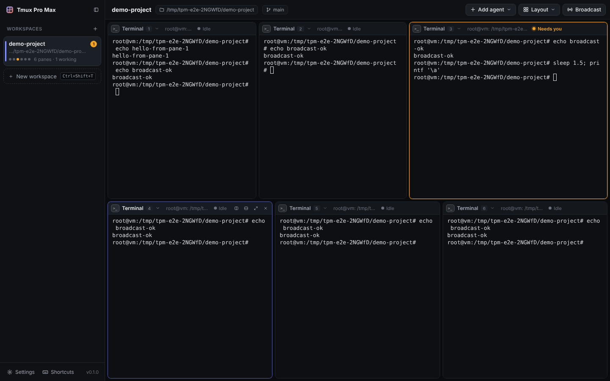
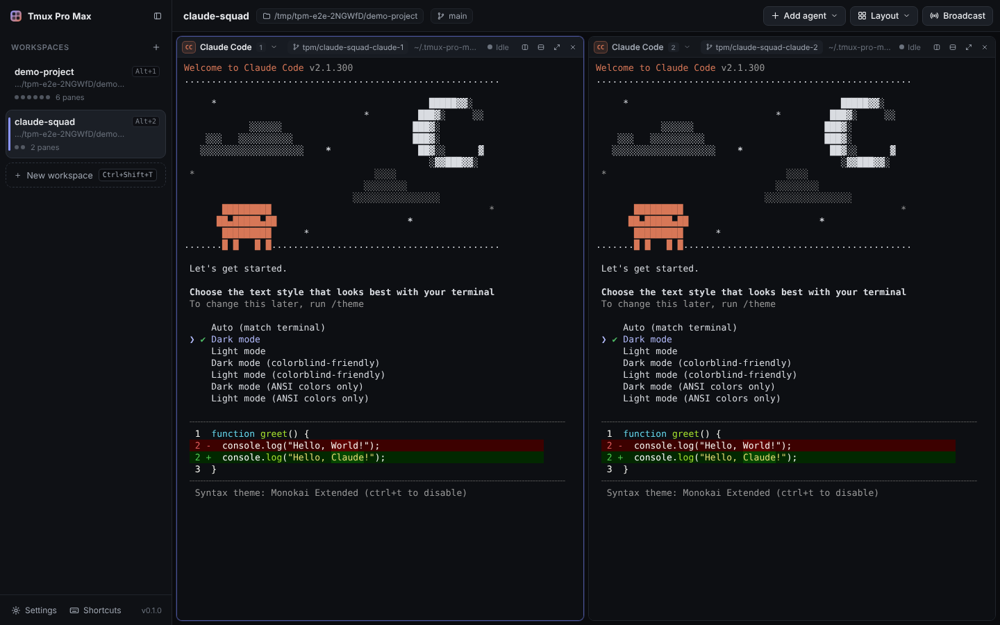
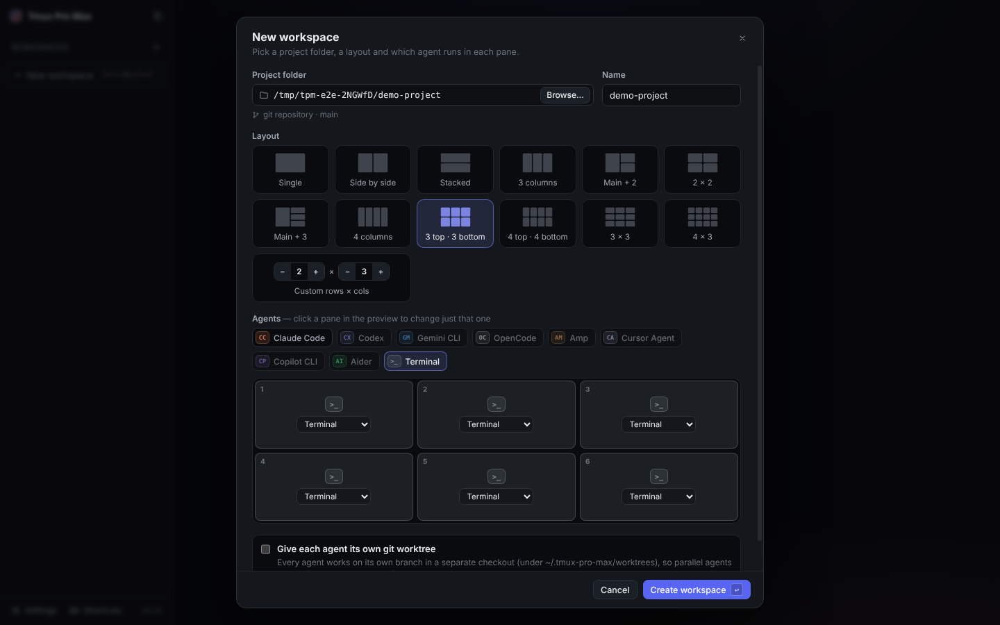

# Tmux Pro Max

A desktop app for running coding agents side by side. Open a project, pick a layout such as **3 on top · 3 below**, and put Claude Code, Codex, Gemini CLI, OpenCode or a plain shell in each pane. Every pane is a real terminal.

It is inspired by cmux, T3 Code and BridgeMind. It runs on macOS, Windows and Linux (Electron + xterm.js + node-pty).



## Features

- **Tiled panes.** Split any pane right or down, drag the dividers to resize, zoom one pane to full size, and drag a pane header onto another pane to swap them. Panes are rendered at fixed positions, so terminals never reset when the layout changes.
- **Layout presets.** Single, side by side, stacked, 3 or 4 columns, main + stack, 2 × 2, 3 top · 3 bottom, 4 top · 4 bottom, 3 × 3 and 4 × 3. You can also enter custom rows × columns up to 4 × 5. Existing panes can be re-tiled at any time from the **Layout** menu.
- **Any agent in any pane.** Built in: Claude Code, Codex, Gemini CLI, OpenCode, Amp, Cursor Agent, Copilot CLI, Aider and Terminal (your login shell). You can change the command for each one (for example `claude --model opus`) or add your own agents. Switch a pane's agent from its header.
- **Workspaces.** The sidebar holds vertical tabs, one per project. Each workspace has its own folder, layout and agents. A workspace's agents start the first time you open it, and they keep running when you switch to another workspace.
- **Broadcast.** Type one prompt and send it to every agent in the workspace, or to the panes you tick. There are quick buttons for Esc, Ctrl+C and Enter.
- **Git worktree isolation.** Optionally, each agent gets its own branch and checkout (`~/.tmux-pro-max/worktrees/...`), so parallel agents never edit the same files. Each pane header shows its branch.
- **Attention tracking.** A pane is flagged with an amber ring, the sidebar shows a badge, and the dock shows a count when:
  - an agent stops working after a stretch of output,
  - an agent rings the terminal bell,
  - an agent sends an OSC 9 or OSC 777 notification.

  If the window is in the background you also get a desktop notification. Clicking it takes you to the pane.

- **Claude Code sessions survive restarts.** Every Claude Code pane gets its own conversation id. When you reopen the app, each pane resumes its own conversation (`--resume <id>`).
- **Restore on launch.** Workspaces, layouts, pane sizes, agents and settings are all restored. If the window reloads, or on macOS you close it and reopen it, it reconnects to the processes that are still running and repaints their recent scrollback.
- **Terminal features you'd expect.**
  - GPU rendering (WebGL), clickable links (⌘/Ctrl + click) and search in a pane.
  - Drag and drop files to paste their paths (handy for giving Claude Code images).
  - Shift+Enter inserts a newline in agent prompts.
  - Flow control, so a flood of output (`seq 1 1500000`) doesn't freeze the UI.

| Claude Code in two worktrees                                                         | New workspace dialog                                                |
| ------------------------------------------------------------------------------------ | ------------------------------------------------------------------- |
|  |  |

## Getting started

Requirements: **Node.js 20+** and git. node-pty ships prebuilt binaries for macOS and Windows. On Linux it compiles during install, which needs `python3`, `make` and a C++ compiler (`sudo apt install build-essential python3`).

```bash
git clone https://github.com/blazespark221-byte/Tmux-pro-max.git
cd Tmux-pro-max
npm install
npm run dev        # run with hot reload
```

To build an installable app:

```bash
npm run dist:mac    # .dmg (arm64 + x64)  → release/
npm run dist:win    # NSIS installer
npm run dist:linux  # AppImage + .deb
```

Install the agents you want to use the way you normally would, for example `npm install -g @anthropic-ai/claude-code`. The app finds them through your login shell's `PATH`. Agents it cannot find are marked "not found" and show their install command.

## Using it

1. **New workspace** (⌘T / Ctrl+Shift+T): choose a folder, a layout and the agent for each pane. Click a pane in the preview to change just that one. If the folder is a git repo you can give each agent its own worktree.
2. Click a pane, or use ⌘⌥←↑→↓ (Ctrl+Shift+arrows on Linux/Windows), to focus it. Type as you would in any terminal.
3. **Broadcast** (⌘⇧B / Ctrl+Shift+B) sends one prompt to all agents at once.
4. Watch the status in each pane header (**Working**, **Idle**, **Needs you**) and the sidebar badges. You can work elsewhere while agents run.

### Keyboard shortcuts

| Action                    | macOS        | Linux / Windows             |
| ------------------------- | ------------ | --------------------------- |
| New workspace             | ⌘T           | Ctrl+Shift+T                |
| Go to workspace 1–9       | ⌘1…9         | Alt+1…9                     |
| Next / previous workspace | ⌘⇧] / ⌘⇧[    | Ctrl+Tab / Ctrl+Shift+Tab   |
| Split right / down        | ⌘D / ⌘⇧D     | Ctrl+Shift+D / Ctrl+Shift+E |
| Close pane                | ⌘W           | Ctrl+Shift+W                |
| Zoom pane                 | ⌘↩           | Ctrl+Shift+Enter            |
| Restart agent in pane     | ⌘⇧R          | Ctrl+Shift+R                |
| Focus pane in a direction | ⌘⌥ arrows    | Ctrl+Shift+arrows           |
| Next / previous pane      | ⌘] / ⌘[      | Ctrl+Shift+] / [            |
| Broadcast                 | ⌘⇧B          | Ctrl+Shift+B                |
| Find in pane              | ⌘F           | Ctrl+Shift+F                |
| Copy / paste              | ⌘C / ⌘V      | Ctrl+Shift+C / V            |
| Font size                 | ⌘= / ⌘- / ⌘0 | Ctrl+= / Ctrl+- / Ctrl+0    |
| Toggle sidebar            | ⌘B           | Ctrl+Shift+S                |
| Settings / all shortcuts  | ⌘, / ⌘/      | Ctrl+, / Ctrl+Shift+/       |

On Linux and Windows every shortcut uses Ctrl+Shift or Alt, so plain Ctrl+C, Ctrl+D, Ctrl+W and the rest still reach the agent.

### Good to know

- Worktrees are never deleted automatically. Remove them with `git worktree remove <path>` when you're done with a branch.
- On macOS, closing the window keeps the agents running in the background, like other Mac apps. Click the dock icon to reconnect, or quit (⌘Q) to stop everything.
- App state is stored in the OS app-data folder (`state.json`). Set `TPM_USER_DATA_DIR` to use a separate profile.
- Each pane gets `TPM_PANE_ID` and `TPM_WORKSPACE_ID` environment variables, so scripts and hooks can tell which pane they run in.

## Development

```bash
npm test                 # unit tests (layout engine, shortcuts)
npm run typecheck
npm run build
xvfb-run -a npm run test:e2e   # end-to-end: drives the built app with Playwright
```

How the code is organised:

- `src/main/`: the Electron main process.
  - `pty-manager.ts` runs one node-pty process per pane. It batches output, applies flow control, and keeps scrollback for re-attaching.
  - `shell-env.ts` reads your login shell's environment so agents can be found on `PATH`.
  - `git.ts` creates the worktrees.
- `src/shared/layout.ts`: the tiling tree (split, remove, resize, presets, geometry, directional focus). It is pure functions with unit tests.
- `src/renderer/`: the React UI. `TerminalPane.tsx` wraps xterm.js. `lib/terminals.ts` routes PTY output straight to the terminals without going through React state. `lib/activity.ts` does the attention detection.
